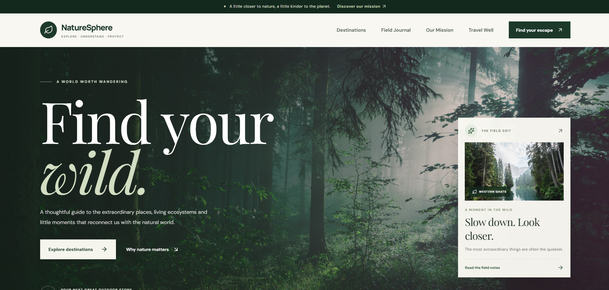
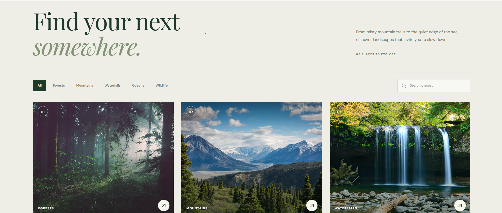
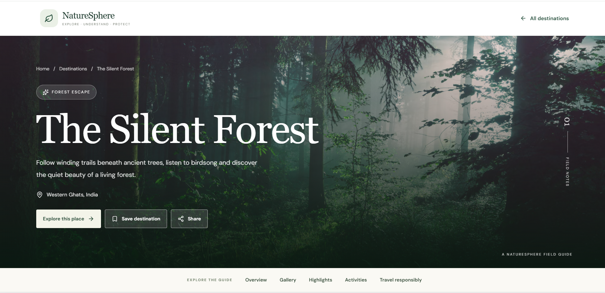
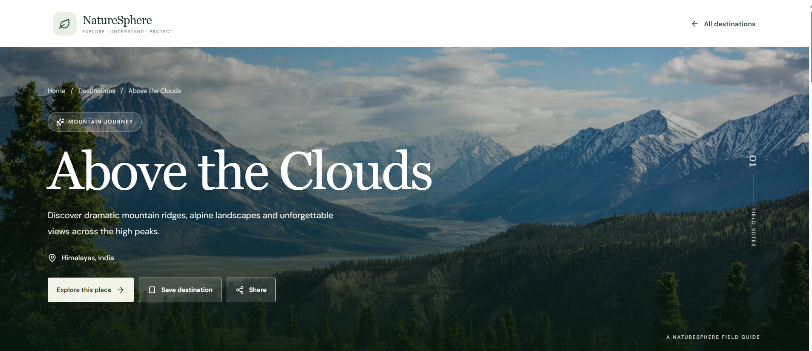
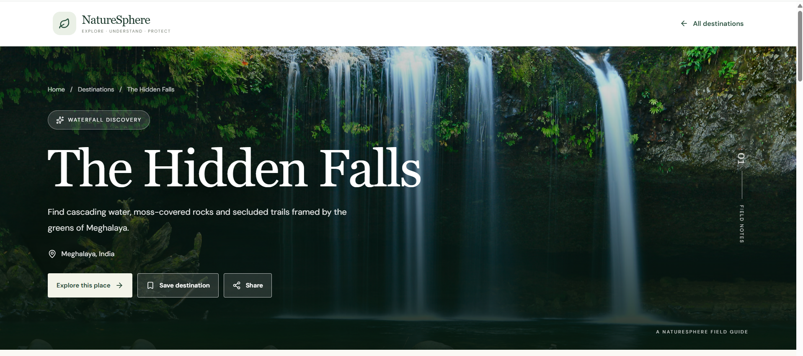
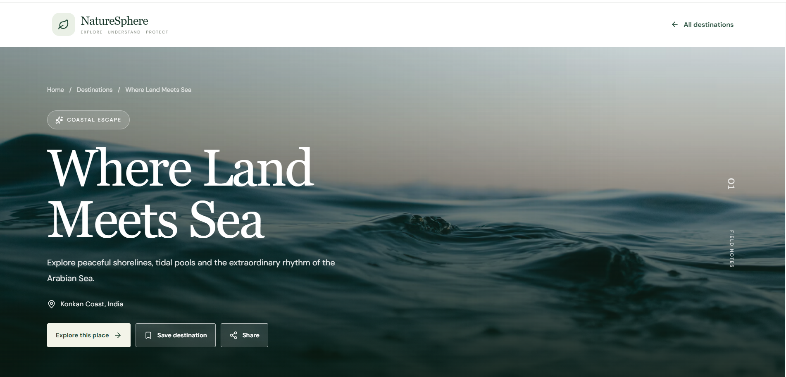

# 🌿 NatureSphere — Discover the Beauty of Nature

**Explore nature. Discover destinations. Travel responsibly.**

NatureSphere is a modern and responsive nature and travel discovery website built to help people explore beautiful destinations, discover natural landscapes, and find inspiration for outdoor adventures.

The website features destinations such as forests, mountains, waterfalls, oceans, and wildlife locations through an attractive and user-friendly interface.

## 🌍 Project Overview

- **Project Name:** NatureSphere
- **Project Type:** Nature and Travel Discovery Website
- **Frontend:** React.js
- **Build Tool:** Vite
- **Language:** JavaScript
- **Styling:** CSS3
- **Developer:** Sakshi Chandivade

## ✨ Features

- 🌲 **Explore Destinations** — Discover beautiful natural places.
- 🔎 **Search Functionality** — Search destinations by name, location, and description.
- 🏞️ **Category Filters** — Browse forests, mountains, waterfalls, oceans, and wildlife.
- 📍 **Destination Details** — Explore information about selected destinations.
- 📰 **Nature Journal** — Discover nature and travel-related content.
- 🌱 **Responsible Travel** — Encourage sustainable and mindful tourism.
- 📱 **Responsive Design** — Enjoy the website on different screen sizes.
- 💌 **Newsletter Interface** — Enter an email address to interact with the newsletter form.
- 🎨 **Modern UI** — Clean layouts, nature-inspired styling, and interactive elements.

## 🛠️ Technologies Used

| Technology | Purpose |
|---|---|
| React.js | Building reusable UI components |
| Vite | Development server and build tool |
| JavaScript | Application logic and interactivity |
| HTML5 | Website structure |
| CSS3 | Styling, layouts, and responsive design |
| React Router | Navigation between pages |
| Lucide React | Icons |
| Unsplash | Nature photography |

## 📸 Screenshots

### 1. Homepage



### 2. Destination View



### 3. Explore Destinations



### 4. Nature Experience



### 5. Destination Details



### 6. Additional Website View



## 🚀 Getting Started

Follow these steps to run the project on your computer.

### Prerequisites

Make sure you have installed:

- [Node.js](https://nodejs.org/)
- npm
- [Git](https://git-scm.com/)

### Installation

**1. Clone the repository**

```bash
git clone https://github.com/sakshichandivade12/NatureSphere.git
```

**2. Navigate to the project folder**

```bash
cd NatureSphere
```

**3. Install dependencies**

```bash
npm install
```

**4. Start the development server**

```bash
npm run dev
```

**5. Open the website**

Open the local URL displayed in your terminal, usually:

```text
http://localhost:5173
```

## 📁 Project Structure

```text
NatureSphere/
├── public/
├── src/
│   ├── screenshots/
│   │   ├── homepage.png
│   │   ├── img1.png
│   │   ├── img2.png
│   │   ├── img3.png
│   │   ├── img4.png
│   │   └── img5.png
│   ├── App.jsx
│   ├── App.css
│   └── ...
├── package.json
├── index.html
└── README.md
```

*Note: The structure above is illustrative. Your actual project may contain additional files and folders.*

## 🎯 Project Objective

The objective of NatureSphere is to create an engaging digital platform for discovering natural destinations and promoting responsible tourism through a modern, accessible, and user-friendly experience.

## 🌟 Future Enhancements

- Interactive maps for destinations
- Save favourite destinations
- User reviews and ratings
- Real-time weather information
- Trip planning and itinerary features
- Backend integration for newsletter subscriptions

## 👩‍💻 Developer

**Sakshi Chandivade**

Computer Engineering Student

GitHub: [@sakshichandivade12](https://github.com/sakshichandivade12)

Project Repository: [NatureSphere on GitHub](https://github.com/sakshichandivade12/NatureSphere)

---

*Discover the beauty of nature, one destination at a time. 🌿*
